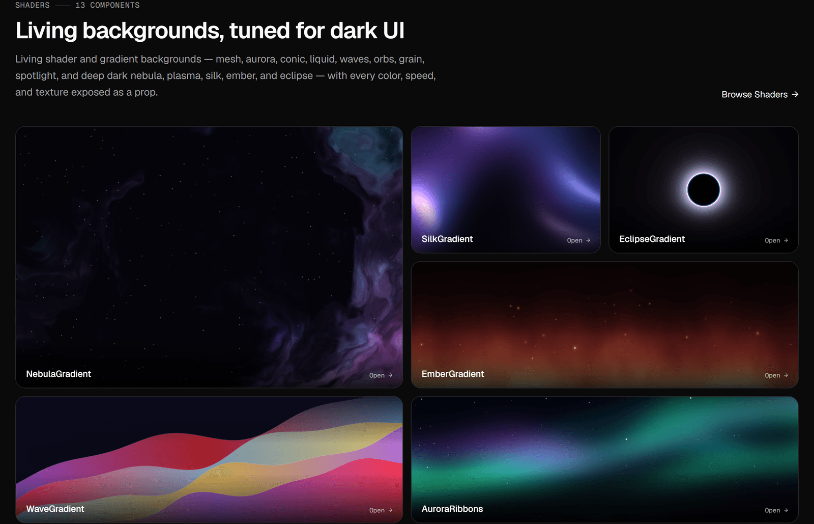
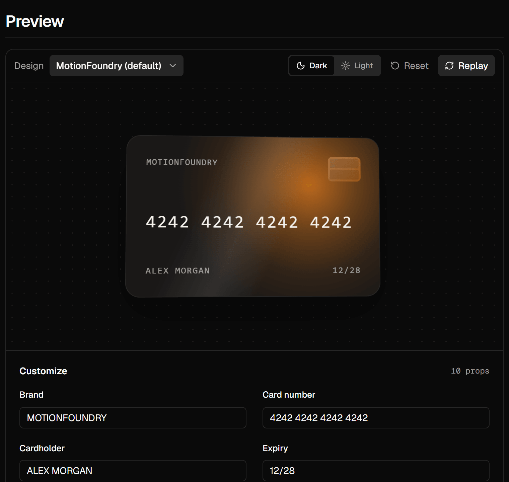

<p align="center"></p>

<h1 align="center">MotionFoundry</h1>

<p align="center">
  <strong>142 animated React components</strong> — smooth scroll, shader backgrounds, and accessible UI primitives — built from scratch with TypeScript, Motion, WebGL, and scoped CSS Modules.
</p>

<p align="center">
  <a href="https://www.npmjs.com/package/@motionfoundry/ui"></a>
  <a href="https://www.npmjs.com/package/motionfoundry"></a>
  <a href="./LICENSE"></a>
</p>

---

## What is MotionFoundry?

MotionFoundry is an open-source library of production-ready animated components for **React 18/19 and Next.js**. Use it two ways:

- **Copy the source** into your project with the `motionfoundry` CLI — you own every line (one `.tsx` + one `.module.css` per component).
- **Install the package** `@motionfoundry/ui` and import components like any other library.

Every component:

- renders a complete demo with **zero props**, and exposes its knobs (colors, speed, easing, sizes, copy…) as **typed props**;
- respects **`prefers-reduced-motion`**, follows **WAI-ARIA** patterns with full keyboard support, and is **SSR-safe**;
- has **no heavy dependencies** — no GSAP, Lenis, Radix, or three.js. 72 components need only React; the rest also use [`motion`](https://motion.dev).

<p align="center">
  
  <br /><sub><b>Shaders</b> — hand-written WebGL and canvas backgrounds, every color and speed a prop.</sub>
</p>

## Components

| Collection | Count | What's inside |
| --- | ---: | --- |
| **Scroll** | 18 | Lenis-style smooth scrolling built from scratch: `SmoothScroll`, `ParallaxLayers`, `StickyStackCards`, `VelocityMarquee`, `ScrollCoverflow`, `PinnedSteps`, `ScrollPathDraw`, `SnapSections`, `ScrollColorShift`, … |
| **Shaders** | 13 | Living backgrounds: `NebulaGradient`, `SilkGradient`, `EclipseGradient`, `EmberGradient`, `PlasmaGradient` (raw WebGL), plus `MeshGradient`, `WaveGradient`, `AuroraRibbons`, `SpotlightGradient`, … |
| **UI** | 55 | Accessible primitives with motion: `Button`, `Select`, `Combobox`, `OtpInput`, `RangeSlider`, `Tabs`, `Dialog`, `Drawer`, `DropdownMenu`, `Toast`, `DataTable`, `BarChart`, `Carousel`, `CreditCard`, `AccordionCards`, `ProgressBar`, `SkeletonShimmer`, … |
| **Text FX** | 8 | GSAP-style text animation without GSAP: `SplitText`, `MaskWipeText`, `ElasticLetters`, `MarkerHighlight`, `CubeFlipWords`, … |
| **Studio Kit** | 24 | Everyday motion: `BlurInText`, `Typewriter`, `NumberTicker`, `ConfettiButton`, `FlipCard`, `SwipeCards`, `Meteors`, `NotificationStack`, … |
| **Core** | 24 | The original primitives: `KineticType`, `MagneticButton`, `HoloTiltCard`, `LiquidGlassCard`, `MagneticDock`, `MorphingCommandPalette`, … |
| **Total** | **142** | across 13 categories |

Run `npx motionfoundry list` for the full list, or `npx motionfoundry list --collection ui` for one collection.

<p align="center">
  
  <br /><sub>Every component has a playground: live preview, Dark / Light and brand-theme presets, prop controls, and copy-ready code.</sub>
</p>

## Quick start

### Option A — copy components into your project (recommended)

```bash
npx motionfoundry add eclipse-gradient credit-card smooth-scroll
```

This writes the source next to your code (under `src/` if it exists):

```
components/ui/eclipse-gradient.tsx
components/styles/eclipse-gradient.module.css
…
```

Then install the peer dependency the CLI prints (usually `motion`) and import from your own files:

```tsx
import { EclipseGradient } from "@/components/ui/eclipse-gradient";
```

### Option B — install the package

```bash
npm install @motionfoundry/ui motion
# or: pnpm add @motionfoundry/ui motion
```

Import the stylesheet **once**, e.g. in your Next.js root layout:

```tsx
// app/layout.tsx
import "@motionfoundry/ui/styles.css";

export default function RootLayout({ children }: { children: React.ReactNode }) {
  return (
    <html lang="en">
      <body>{children}</body>
    </html>
  );
}
```

## Using it in your code

Components are client components (the bundle is marked `"use client"`), so you can render them straight from a Server Component page:

```tsx
// app/page.tsx
import { Button, CreditCard, EclipseGradient, SmoothScroll, Toast } from "@motionfoundry/ui";

export default function Page() {
  return (
    <main>
      {/* A shader background with your content on top */}
      <EclipseGradient height={420} speed={3}>
        <h1>Ship interfaces that feel considered.</h1>
      </EclipseGradient>

      {/* Smooth, eased scrolling inside its own viewport */}
      <SmoothScroll height={360} showProgress>
        <section>…your long content…</section>
      </SmoothScroll>

      {/* UI primitives with sensible defaults — override what you need */}
      <CreditCard holder="ADA LOVELACE" glowColor="#38bdf8" maskNumber />
      <Button variant="outline" label="Get started" href="/docs" />
      <Toast position="bottom-right" title="Deployed to production" />
    </main>
  );
}
```

Every prop is optional — `<CreditCard />` on its own renders a full demo. Controlled and uncontrolled APIs are supported where they make sense (`value` / `defaultValue` / `onValueChange`, `open` / `defaultOpen` / `onOpenChange`).

### Theming

Components read their surfaces, text, borders, and accent from `--mf-*` CSS variables (each with a built-in fallback), so you can restyle everything inside a wrapper — or the whole app via `:root`:

```css
.brand-theme {
  --mf-bg: #ffffff;
  --mf-surface: #fafafa;
  --mf-fg: #171717;
  --mf-muted: #4d4d4d;
  --mf-border: #ebebeb;
  --mf-accent: #0070f3;
}
```

The repo also ships **11 brand design systems** (Vercel, Cursor, Claude, Framer, Apple, Airbnb, Expo, ElevenLabs, Runway, Resend, Spotify) as `DESIGN.md` files in [`design-md/`](./design-md), each with a ready-made theme you can apply in the docs playground.

## Run the docs locally

```bash
git clone https://github.com/nitin-inloop/Motionfoundry.git
cd Motionfoundry
pnpm install
pnpm dev        # http://localhost:3000
```

See **[SETUP.md](./SETUP.md)** for builds, tests, the CLI, deployment, and publishing.

## Repository layout

| Path | Purpose |
| --- | --- |
| `packages/ui` | `@motionfoundry/ui` — component source (`src/components`, `src/styles`) and the compiled bundle |
| `packages/cli` | `motionfoundry` CLI — copies component source into your app |
| `registry/` | Per-component metadata (props, controls, a11y notes) and the generated manifest |
| `apps/docs` | Next.js docs site with live playgrounds |
| `design-md/` | Brand DESIGN.md files and their themes |

## Contributing

Contributions are welcome — see [CONTRIBUTING.md](./CONTRIBUTING.md). Run `pnpm check` before opening a pull request.

## License

[MIT](./LICENSE) © MotionFoundry contributors
